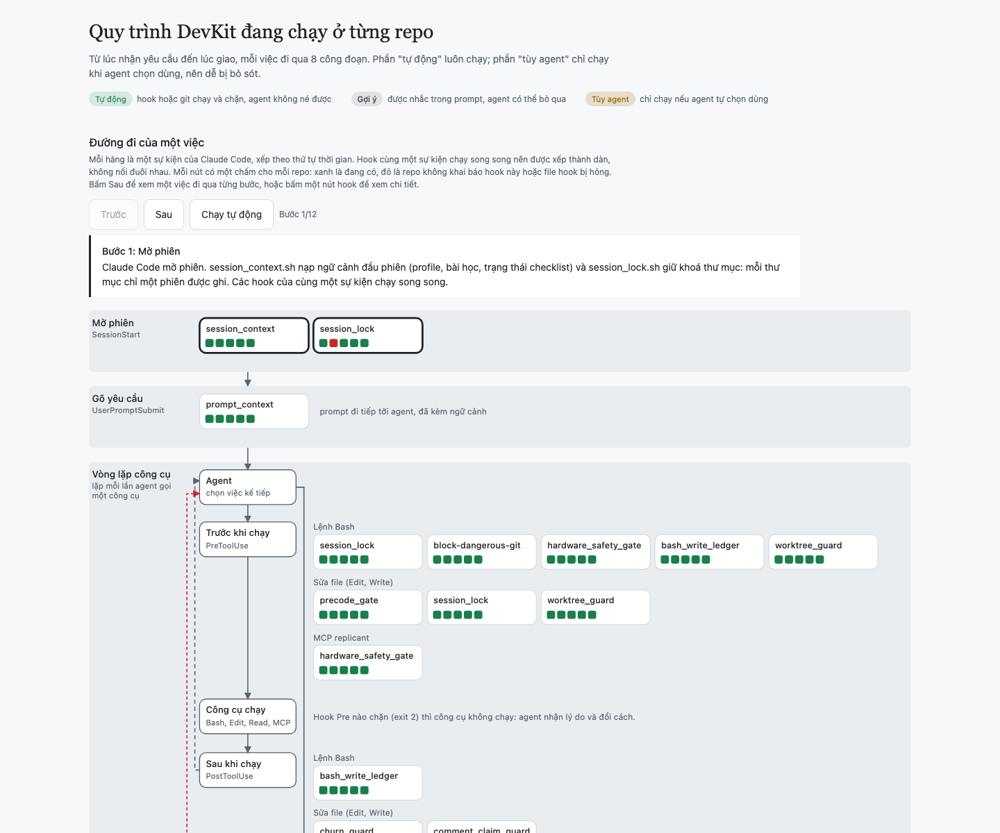
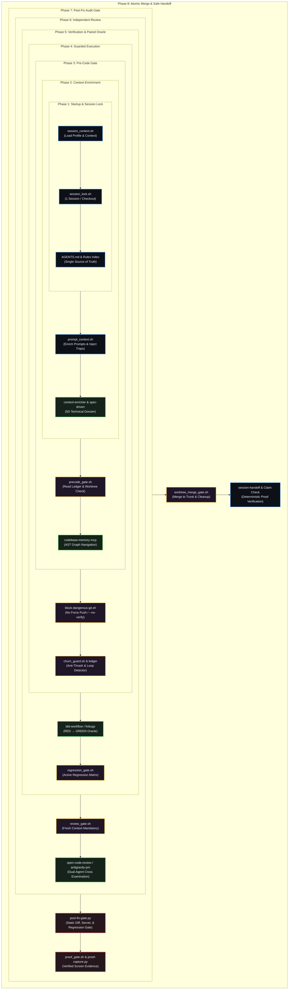

<div align="center">

# ⚡ Agent Workbench
### *The Zero-Defect Engineering & Quality Operating System for AI Coding Agents*

[](https://github.com/ToanMobile/agent-workbench)
[](universal-agent-devkit/)
[](#-universal-multi-agent-matrix)
[](universal-agent-devkit/skills/)
[](universal-agent-devkit/profiles/)
[](LICENSE)

<p align="center">
  <b>Transform conversational LLMs into rigorous, disciplined Principal Engineers.</b><br>
  Enforce deterministic lifecycle hooks, paired test oracles (RED &rarr; GREEN), zero secret leaks, and automated post-fix gates across all your AI agent workflows.
</p>

[Interactive Workflow Demo](#-interactive-workflow-map--live-demo) • [Core Components](#-monorepo-components) • [DevKit Platform](#-core-platform-universal-agent-devkit) • [Quick Start](#-quick-start) • [Companion MCPs](#-companion-mcp-servers) • [Architecture](#-repository-architecture--history)

---

</div>

## 🗺️ Interactive Workflow Map & Live Demo

DevKit features a self-contained, interactive visual dashboard that inspects and maps the entire multi-phase execution pipeline across all active projects and sessions in real-time.

<div align="center">

<a href="universal-agent-devkit/dashboard/workflow-map.html">
  
</a>

<p align="center">
  <b>Live Diagnostic Dashboard</b>: Visualizing the 8-phase execution lifecycle, active hooks, domain profiles, and parallel worktrees.<br>
  👉 <b><a href="universal-agent-devkit/dashboard/workflow-map.html">Click here to open the Interactive HTML Dashboard</a></b> 👈
</p>

```bash
# Or launch directly in your default browser:
open universal-agent-devkit/dashboard/workflow-map.html
```

</div>



The offline dashboard [universal-agent-devkit/dashboard/workflow-map.html](universal-agent-devkit/dashboard/workflow-map.html) provides:
* **Real-time Lifecycle Diagnostics**: Inspect active hooks registered in `SessionStart`, `UserPromptSubmit`, `PreToolUse`, `PostToolUse`, `Stop`, and `SessionEnd`.
* **Profile-Aware Filtering**: Highlights active rules and hides out-of-scope tools (e.g., skips Android AVD tools on Backend profiles).
* **Worktree & Trunk Isolation**: Live status of detached worktrees, unmerged patches, and session ownership.

---

## 📦 Monorepo Components

The workbench brings together the flagship DevKit alongside enterprise-grade MCP servers into a cohesive monorepo:

| Component | Role | Description | Stack |
| :--- | :--- | :--- | :--- |
| **[`universal-agent-devkit/`](universal-agent-devkit/)** | 🚀 **Core Platform** | **Flagship AI Quality Protocol**: 35 curated skills, 8 domain profiles, post-fix diff gate, anti-fabrication claim verification, and collision safeguards. | Shell + Python + Node |
| **[`mcp-servers/antigravity-pm-mcp/`](mcp-servers/antigravity-pm-mcp/)** | 🤖 **PM Orchestration** | **Leader PM ↔ Worker Protocol**: Enables Claude Code to direct Google Antigravity in an isolated sandbox, grill plans, audit diffs, and enforce acceptance gates. | Node (ESM) |
| **[`mcp-servers/play-store-mcp/`](mcp-servers/play-store-mcp/)** | 📱 **Distribution Hub** | **Google Play Console MCP**: Full lifecycle management for Android apps (AAB/APK upload, track promotion, release rollouts, and review replies). | Python (uv) |

---

## 🚀 Core Platform: Universal Agent DevKit

Traditional LLMs write code eagerly but frequently hallucinate test outcomes, drop existing functions with `// ... existing code ...`, accidentally commit secrets (`.env`, `.keystore`), or trigger destructive git commands. 

**Universal Agent DevKit** solves this deterministically at the OS and tool execution layer:

```
┌────────────────────────────────────────────────────────────────────────┐
│                        UNIVERSAL AGENT DEVKIT                          │
├───────────────────┬───────────────────┬────────────────────────────────┤
│ 🛡️ Strict Defense │ 🧠 Domain Context │ 🔬 Verified Delivery           │
├───────────────────┼───────────────────┼────────────────────────────────┤
│ • Pre-Code Gate   │ • Android/Kotlin  │ • Paired Oracle (RED → GREEN)  │
│ • Git Guardrails  │ • iOS/Swift       │ • Post-Fix Audit Gate (Exit 0) │
│ • Secret Shields  │ • Web/Frontend    │ • Mandatory Visual Proof PNG   │
│ • No Lazy Diff    │ • Backend/Cloud   │ • Dual-Agent Cross-Review      │
│ • Session Locks   │ • Automotive/Game │ • Regression Matrix Checklists │
└───────────────────┴───────────────────┴────────────────────────────────┘
```

### Complete Documentation
* 📖 **[DevKit Master Documentation (English)](universal-agent-devkit/README.md)**
* 📖 **[Tài Liệu Chi Tiết DevKit (Tiếng Việt)](universal-agent-devkit/README.vi.md)**
* 📜 **[Rulebook & Engineering Standards (AGENTS.md)](universal-agent-devkit/AGENTS.md)**

---

## ⚡ Quick Start

### 1. Enable DevKit for this Monorepo
When cloning `agent-workbench`, run this **once from the repository root** to wire up local lifecycle hooks, active profile rules, and safety gates for Claude Code and Gemini CLI:

```bash
cd agent-workbench

# Initialize hooks and wire up profile rules (symlink mode, non-destructive):
bash universal-agent-devkit/bin/agent-kit init . -y -a claude,gemini

# Verify installation health (100/100 PASS):
python3 universal-agent-devkit/bin/agent-health.py -t .
```

> **Why this step is needed**: `.claude/hooks/` and `.agents/devkit` use machine-local symlinks and are intentionally ignored by git to keep collaborator machines clean. Initializing creates these local links without modifying any tracked files.

### 2. Install `agent-kit` Globally on Your Machine
You can use the DevKit protocol across **any codebase** on your machine (Android, iOS, Web, Backend, Unity):

```bash
cd agent-workbench/universal-agent-devkit
make install

# Now install DevKit into any project in 5 seconds:
cd ~/my-other-project
agent-kit init
```

---

## 🛠️ Companion MCP Servers

### 1. `antigravity-pm-mcp` (Leader PM ↔ Worker Sandbox Protocol)
Allows Claude Code to act as a rigorous Principal Tech Lead directing Google Antigravity agents in a protected, detached worktree.
* **Giao Task**: Dispatches clear requirements with explicit verification criteria.
* **Grill Plan**: Stress-tests implementation proposals before code is touched.
* **Enforced Audit**: Inspects diffs, verifies test execution logs, and blocks unverified completions.

```bash
cd mcp-servers/antigravity-pm-mcp
npm install
npm test
```

### 2. `play-store-mcp` (Google Play Developer Automation)
Provides LLMs with safe, structured MCP tools to manage Google Play Console operations:
* Validates package bundles, draft releases, and staged rollouts.
* Inspects Crashlytics Android stack traces and production vitals.
* Retrieves and responds to Play Store user reviews safely.

```bash
cd mcp-servers/play-store-mcp
uv sync
uv run pytest
```

---

## 🏛️ Repository Architecture & History

* **Monorepo Evolution**: This repository was originally created as `play-store-mcp` and was expanded and renamed to `agent-workbench` on September 14, 2026. All legacy history is preserved under [`mcp-servers/play-store-mcp/`](mcp-servers/play-store-mcp/).
* **Subtree Integration**: Both `universal-agent-devkit` and `mcp-servers/antigravity-pm-mcp` were integrated using `git subtree add`, preserving their original commit history and lineage.
* **Trunk & Parallel Worktree Isolation**: The monorepo utilizes DevKit's trunk mode—main is merge-only, and parallel agent sessions develop inside lightweight, zero-copy APFS worktrees (`agent-kit worktree add`) to eliminate race conditions and dirty working tree collisions.
* **Continuous Integration**: Subprojects maintain individual test suites. Workflows in the root `.github/workflows/` coordinate multi-agent regression tests across all monorepo components.

---

<div align="center">

Built with precision for autonomous AI engineering teams.  
Contributions, bug reports, and domain profile extensions are welcome!

</div>
